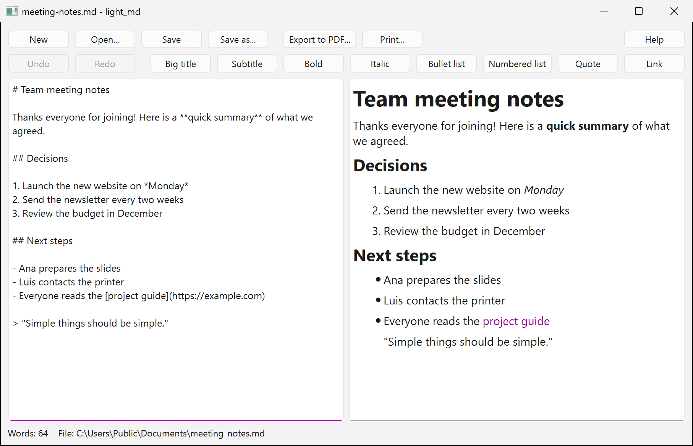

# light_md

[English](README.md) | [Español](README.es.md) | [Português](README.pt.md) | [Français](README.fr.md) | **Deutsch**

Ein schlanker Markdown-Editor in C++ und Qt 6, gemacht für Menschen, die nicht in der IT arbeiten.

Links schreiben, rechts das schön formatierte Ergebnis lesen. Markdown-Kenntnisse sind nicht nötig: Die Schaltflächen oben übernehmen die Formatierung für dich.



**[light_md für Windows herunterladen](https://github.com/josel120/light_md/releases/latest)**: Archiv entpacken und `bin\light_md.exe` öffnen. Keine Installation nötig.

> Die Oberfläche der Anwendung ist auf Englisch. Die Namen der Schaltflächen stehen unten so, wie sie auf dem Bildschirm erscheinen.

## Was es kann

- Zwei Bereiche: links schreiben, rechts lesen, mit sofortiger Vorschau.
- Schaltflächen mit Alltagswörtern: New (neu), Open (öffnen), Save (speichern), Big title (große Überschrift), Bold (fett), Bullet list (Aufzählung), Quote (Zitat), Link usw.
- Öffnet und speichert `.md`-Dokumente, auch per Drag-and-drop ins Fenster oder über „Öffnen mit“ im Datei-Explorer.
- Export als PDF und Drucken: Das Ergebnis sieht genauso aus wie der rechte Bereich.
- Rückgängig und Wiederholen sowie Tastenkürzel (Strg+S, Strg+Z, Strg+B, Strg+I, Strg+K, Strg+1, Strg+2).
- Wortzähler und Warnung bei ungespeicherten Änderungen, auch beim Schließen des Fensters.
- Eine Help-Schaltfläche (Hilfe) mit einer kurzen Anleitung.

## Kompilieren (Windows, mit Qt 6 und MinGW)

Du brauchst eine Qt-6-Installation (zum Beispiel in `C:\Qt`) mit dem mitgelieferten CMake und Ninja.

```powershell
$env:PATH = "C:\Qt\Tools\mingw1510_64\bin;C:\Qt\6.12.1\mingw_64\bin;$env:PATH"
C:\Qt\Tools\CMake_64\bin\cmake.exe -S . -B build -G Ninja -DCMAKE_PREFIX_PATH=C:/Qt/6.12.1/mingw_64
C:\Qt\Tools\CMake_64\bin\cmake.exe --build build
.\build\light_md.exe
```

Passe die Pfade an, falls deine Qt- oder MinGW-Version eine andere ist.

## Auf einen anderen Computer mitnehmen

So erstellst du einen Ordner, der auf jedem Windows-PC ohne Qt-Installation läuft:

```powershell
C:\Qt\Tools\CMake_64\bin\cmake.exe --install build --prefix dist
```

Kopiere den kompletten Ordner `dist` und öffne `dist\bin\light_md.exe`.

## Lizenz

MIT
