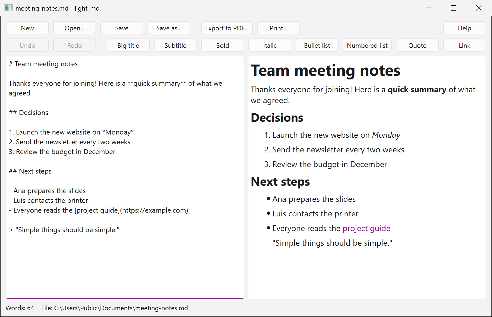

# light_md

**English** | [Español](README.es.md) | [Português](README.pt.md) | [Français](README.fr.md) | [Deutsch](README.de.md)

A lightweight Markdown editor in C++ and Qt 6, made for people who don't work in tech.

Write on the left and read the nicely formatted result on the right. You don't need to know Markdown: the buttons at the top do the formatting for you.



**[Download light_md for Windows](https://github.com/josel120/light_md/releases/latest)**: unzip it and open `bin\light_md.exe`. Nothing to install.

## What it does

- Two panes: writing on the left, reading on the right, with an instant preview.
- Buttons in everyday words: New, Open, Save, Big title, Bold, Bullet list, Quote, Link, etc.
- Open and save `.md` documents, also by dragging them onto the window or using "Open with" from File Explorer.
- Export to PDF and print: the result looks just like the right pane.
- Undo and redo, plus keyboard shortcuts (Ctrl+S, Ctrl+Z, Ctrl+B, Ctrl+I, Ctrl+K, Ctrl+1, Ctrl+2).
- Word count and an unsaved-changes warning, including when closing the window.
- A Help button with a short guide.

## Build (Windows, with Qt 6 and MinGW)

You need Qt 6 installed (for example in `C:\Qt`) with its CMake and Ninja.

```powershell
$env:PATH = "C:\Qt\Tools\mingw1510_64\bin;C:\Qt\6.12.1\mingw_64\bin;$env:PATH"
C:\Qt\Tools\CMake_64\bin\cmake.exe -S . -B build -G Ninja -DCMAKE_PREFIX_PATH=C:/Qt/6.12.1/mingw_64
C:\Qt\Tools\CMake_64\bin\cmake.exe --build build
.\build\light_md.exe
```

Adjust the paths if your Qt or MinGW version is different.

## Take it to another computer

To create a folder that runs on any Windows PC without installing Qt:

```powershell
C:\Qt\Tools\CMake_64\bin\cmake.exe --install build --prefix dist
```

Copy the whole `dist` folder and open `dist\bin\light_md.exe`.

## License

MIT
